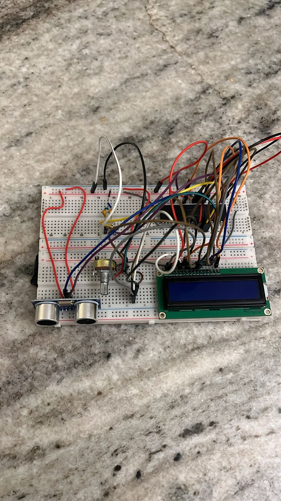

# Ultrasonic Distance Sensor

[](https://www.microchip.com/en-us/product/PIC16F877A)
[](https://www.mikroe.com/mikroc-pic)
[](https://www.labcenter.com/)
[](https://www.sparkfun.com/products/13959)
[](LICENSE)

A contactless distance meter built around a **PIC16F877A** microcontroller. An **HC-SR04**
ultrasonic sensor measures the time of flight of a sound pulse, the PIC converts it to
centimetres with **Timer1**, and a **16×2 LCD** displays the result.

Built for the Interface Circuits course: written in C for **MikroC PRO for PIC**, simulated in
**Proteus**, then assembled on a breadboard.



## How it works

1. The PIC pulls **TRIG** high for 10 µs, which makes the HC-SR04 emit an 8-cycle 40 kHz burst.
2. The sensor raises **ECHO** for as long as the pulse takes to travel to the object and back.
3. The PIC waits for ECHO to go high, starts **Timer1**, waits for it to fall, then stops the timer.
4. Timer1 ticks every 1 µs, so the echo time in microseconds is read directly from `TMR1H:TMR1L`.
5. Distance in centimetres is `time / 58` — the speed of sound gives ~58 µs per centimetre for a
   round trip.
6. Readings between **2 cm and 400 cm** are printed on the LCD; anything outside that window
   shows `Out of range`. The loop repeats every 400 ms.

### Timer setup

With an 8 MHz crystal, `Fosc/4 = 2 MHz`, so one instruction cycle is 0.5 µs. A 1:2 prescaler
(`T1CON = 0x10`) gives exactly **1 µs per Timer1 tick**, which keeps the `/58` conversion simple
and accurate.

## Hardware

| Component | Notes |
| --- | --- |
| PIC16F877A | 8 MHz crystal, 2 × 22 pF load capacitors |
| HC-SR04 | Ultrasonic transmitter/receiver, 2–400 cm range |
| LCD 16×2 (LM016L) | HD44780-compatible, driven in 4-bit mode |
| 10 kΩ potentiometer | LCD contrast (`VEE`) |
| 5 V supply | Common ground for all modules |

### Pin connections

| PIC pin | Signal | Connects to |
| --- | --- | --- |
| RB0 | Output | HC-SR04 `TRIG` |
| RB4 | Input | HC-SR04 `ECHO` |
| RD2 | Output | LCD `RS` |
| RD3 | Output | LCD `E` |
| RD4 – RD7 | Output | LCD `D4` – `D7` (4-bit data) |
| OSC1 / OSC2 | — | 8 MHz crystal + 22 pF capacitors |
| MCLR | — | Pull-up to VDD |

LCD `VSS` → GND, `VDD` → +5 V, `VEE` → potentiometer wiper.


## Repository contents

| Path | What it is |
| --- | --- |
| `Interface Project/InterFace Project.c` | Firmware source (MikroC PRO for PIC) |
| `Interface Project/InterFace Project.mcppi` | MikroC project file — open this to build |
| `Interface Project/InterFace Project.hex` | Compiled firmware, load this into the Proteus MCU |
| `Interface Project/interface final project.pdsprj` | Proteus simulation |
| `Documentation.pdf` | Full project report |
| `circuit.png` | Photo of the assembled breadboard |
| `Proteus circuit.png` | Schematic as drawn in Proteus |

## Running the simulation

1. Open `Interface Project/interface final project.pdsprj` in Proteus.
2. Double-click the PIC16F877A and confirm **Program File** points to
   `Interface Project/InterFace Project.hex`.
3. Press **Play**, then drag the target in front of the HC-SR04 to change the distance — the
   LCD updates live.

## Rebuilding the firmware

1. Open `Interface Project/InterFace Project.mcppi` in **MikroC PRO for PIC**.
2. Build the project (the LCD library must be enabled in the Library Manager).
3. Copy the generated `.hex` back into the Proteus project if you changed the code.

The code is plain C with the MikroC LCD library, so the structure maps easily to XC8 if you
want to move to MPLAB X:

```c
PORTB.F0 = 1;  Delay_us(10);  PORTB.F0 = 0;   // trigger
while(!PORTB.F4);                             // wait for echo high
T1CON.F0 = 1;                                 // start Timer1
while(PORTB.F4);                              // wait for echo low
T1CON.F0 = 0;                                 // stop Timer1
distance = ((TMR1H << 8) | TMR1L) / 58;       // µs → cm
```

## Limitations

- **No echo timeout.** If nothing reflects the pulse, `while(!PORTB.F4)` blocks forever and the
  display freezes. A production version should time out after ~38 ms (≈ 6.5 m round trip).
- **Integer truncation.** `distance / 58` drops the fractional centimetre, so readings have
  ±1 cm granularity.
- **Temperature ignored.** The speed of sound changes with air temperature (~0.6 % per °C),
  which shifts the `/58` constant.
- **Single sensor.** No averaging or median filtering, so soft or angled surfaces can produce
  jitter.

## License

Released under the [MIT License](LICENSE).
